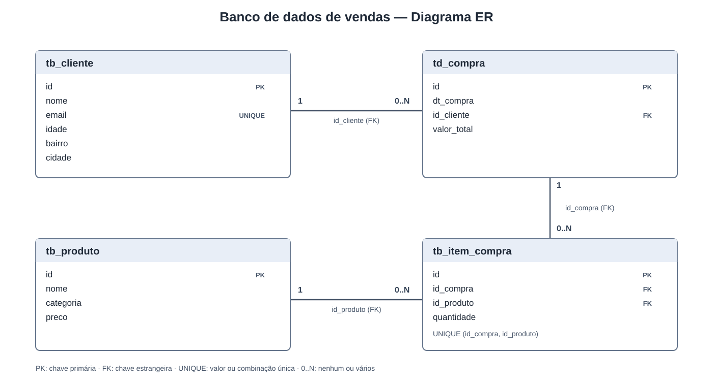

# analise-vendas
Projeto de exemplo de análise de vendas

## Cálculos financeiros

O arquivo `funcoes_simples.py` solicita os dados no terminal e calcula juros compostos e
VPL. Execute com `python funcoes_simples.py`.

- Juros compostos: informe o capital, a taxa por período em percentual e a
  quantidade de períodos.
- VPL: informe a taxa de desconto em percentual e os fluxos de caixa separados
  por vírgula, começando pelo investimento inicial no período zero (geralmente
  um valor negativo). Os fluxos seguintes correspondem aos períodos 1, 2 e
  assim por diante.

## Banco de dados de vendas

O arquivo `criar_banco.py` cria o banco SQLite `vendas.db`, com as tabelas
`tb_produto`, `tb_cliente`, `td_compra` e `tb_item_compra`. O diagrama ER abaixo
mostra suas colunas, chaves e relacionamentos:

Cada tabela recebe mais de 100 registros de exemplo, e as compras têm itens
relacionados a produtos e clientes.

Gere ou atualize o banco executando `python criar_banco.py`. O preenchimento
usa dados reproduzíveis e pode ser executado novamente sem duplicar os
registros gerados. O banco pode ser aberto com qualquer ferramenta compatível
com SQLite.

## API de vendas

Instale as dependências com `python -m pip install -r requirements.txt` e
inicie a API com `python -m uvicorn api:app --reload`. A documentação interativa
fica disponível em `http://127.0.0.1:8000/docs`. Se `vendas.db` ainda não
existir, a API o cria e popula ao iniciar. Defina `VENDAS_DB_PATH` para usar
outro arquivo SQLite.

Endpoints disponíveis:

- `GET /resumo-vendas`: lista compras e totais. Filtros opcionais: `valor_minimo`,
  `valor_maximo`, `cliente_id`, `data_inicio` e `data_fim` (datas no formato
  `AAAA-MM-DD`).
- `GET /analise-clientes`: retorna compras, valor total gasto e ticket médio por
  cliente. Aceita `cidade`, `bairro`, `quantidade_compras_min`,
  `quantidade_compras_max`, `valor_compra_min` e `valor_compra_max`. Os filtros
  de valor se aplicam ao total gasto pelo cliente. Também aceita `limite` e
  `deslocamento` para paginação.
- `GET /analise-produtos`: retorna listas de maior e menor potencial, limitadas
  por `limite`. Como o banco não registra estoque nem margem, o potencial é
  classificado pelo faturamento acumulado; as unidades vendidas servem de
  desempate.
- `GET /analise-compras`: resume quantidade de compras, clientes distintos,
  faturamento e ticket médio; aceita `data_inicio` e `data_fim`.

Para rodar os testes de integração, instale também as dependências de
desenvolvimento com `python -m pip install -r requirements-dev.txt` e execute
`python -m unittest discover -s tests`.
