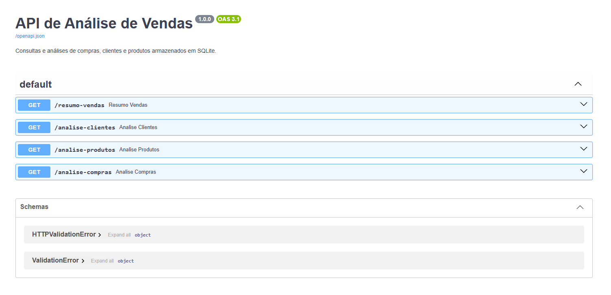
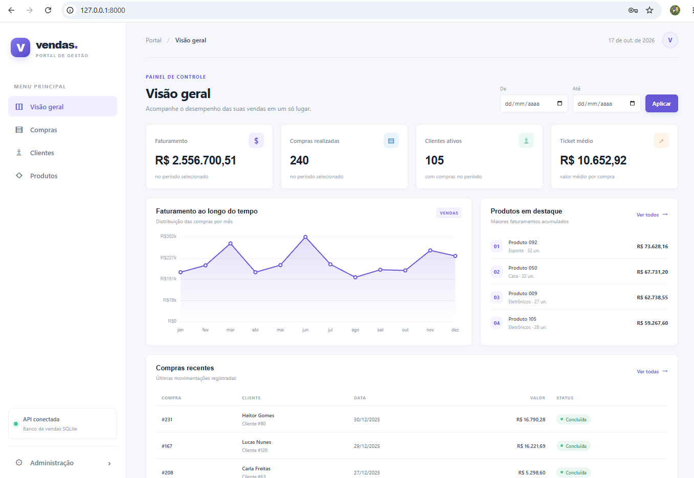
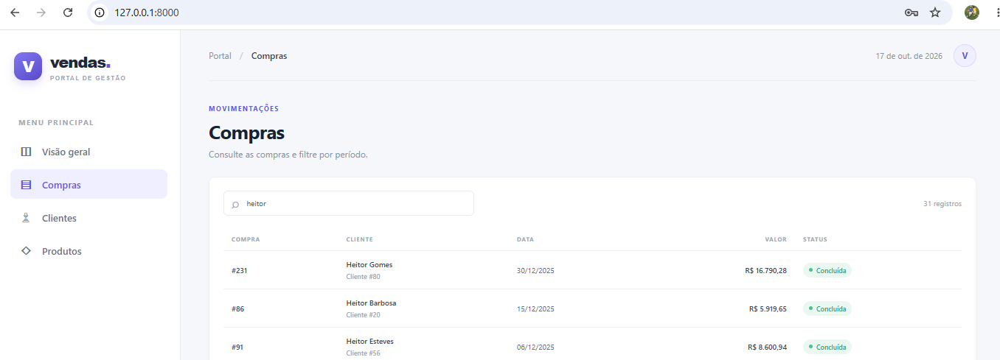
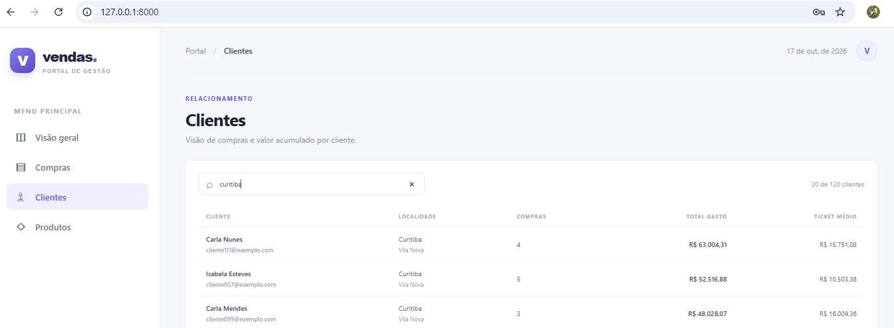
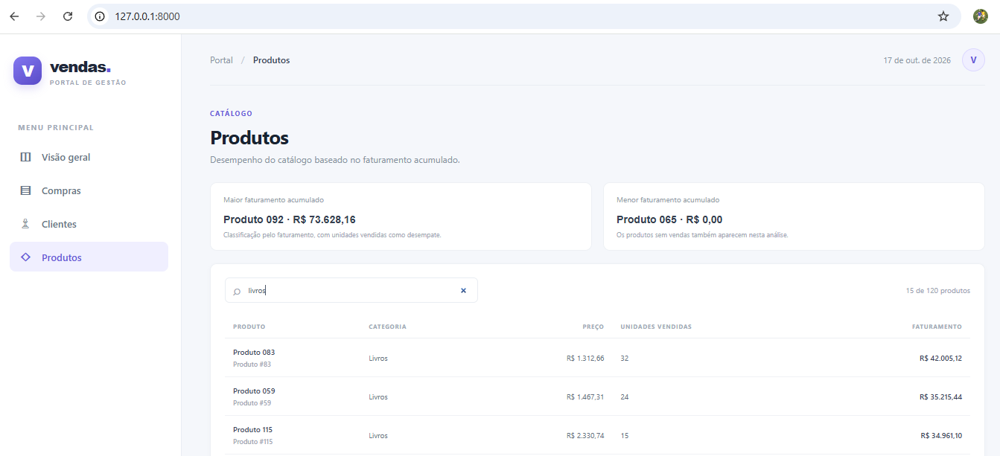
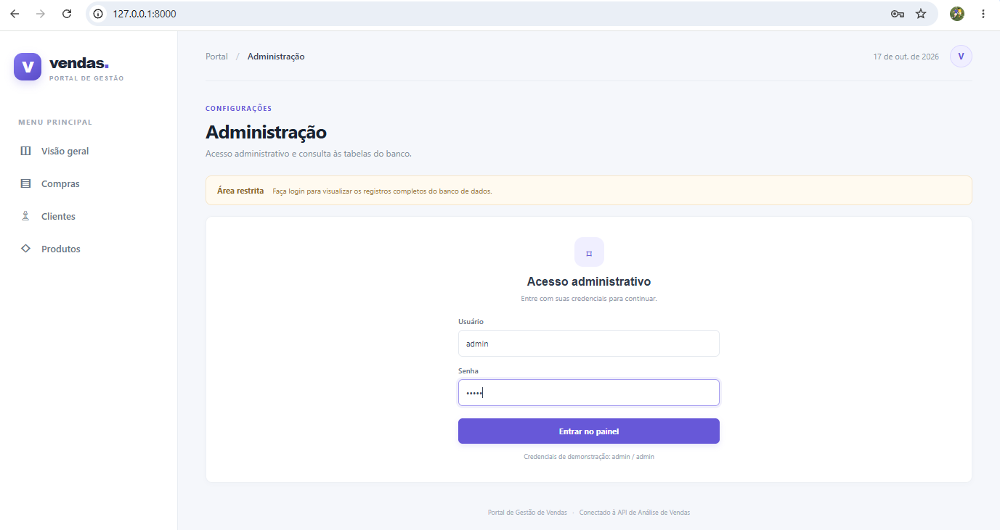
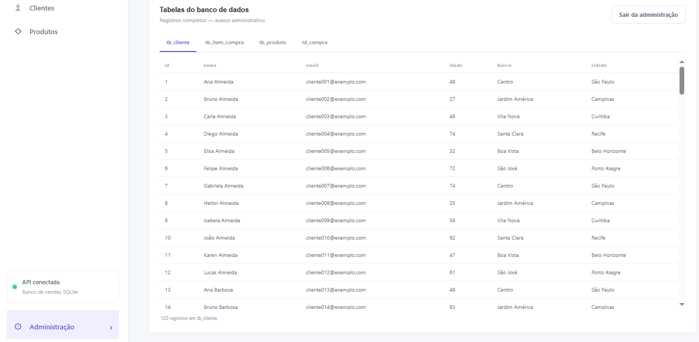
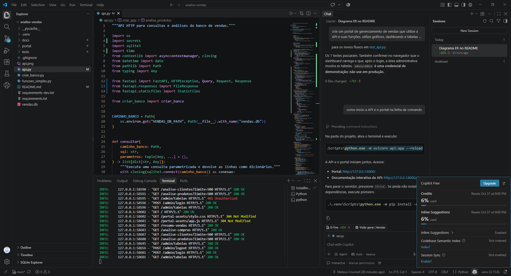

# analise-vendas
Projeto de exemplo de análise de vendas

## Cálculos financeiros

O arquivo `funcoes_simples.py` solicita os dados no terminal e calcula juros compostos e
VPL. Execute com `python funcoes_simples.py`.

- Juros compostos: informe o capital, a taxa por período em percentual e a
  quantidade de períodos.
- VPL: informe a taxa de desconto em percentual e os fluxos de caixa separados
  por vírgula, começando pelo investimento inicial no período zero (geralmente
  um valor negativo). Os fluxos seguintes correspondem aos períodos 1, 2 e
  assim por diante.

## Banco de dados de vendas

O arquivo `criar_banco.py` cria o banco SQLite `vendas.db`, com as tabelas
`tb_produto`, `tb_cliente`, `td_compra` e `tb_item_compra`. O diagrama ER abaixo
mostra suas colunas, chaves e relacionamentos:


Cada tabela recebe mais de 100 registros de exemplo, e as compras têm itens
relacionados a produtos e clientes.

Gere ou atualize o banco executando `python criar_banco.py`. O preenchimento
usa dados reproduzíveis e pode ser executado novamente sem duplicar os
registros gerados. O banco pode ser aberto com qualquer ferramenta compatível
com SQLite.

## API de vendas

Instale as dependências com `python -m pip install -r requirements.txt` e
inicie a API com `python -m uvicorn api:app --reload`. A documentação interativa
fica disponível em `http://127.0.0.1:8000/docs`. Se `vendas.db` ainda não
existir, a API o cria e popula ao iniciar. Defina `VENDAS_DB_PATH` para usar
outro arquivo SQLite.



O portal de gerenciamento também fica disponível na raiz da aplicação, em
`http://127.0.0.1:8000/`. Ele apresenta indicadores, gráficos e tabelas de
compras, clientes e produtos, consumindo os endpoints da API. O menu
**Administração** permite consultar os registros de todas as tabelas após o
login de demonstração (`admin` / `admin`). Essas credenciais fixas são apenas
para uso local e não devem ser usadas em produção.

Endpoints disponíveis:

- `GET /resumo-vendas`: lista compras e totais. Filtros opcionais: `valor_minimo`,
  `valor_maximo`, `cliente_id`, `data_inicio` e `data_fim` (datas no formato
  `AAAA-MM-DD`).
- `GET /analise-clientes`: retorna compras, valor total gasto e ticket médio por
  cliente. Aceita `cidade`, `bairro`, `quantidade_compras_min`,
  `quantidade_compras_max`, `valor_compra_min` e `valor_compra_max`. Os filtros
  de valor se aplicam ao total gasto pelo cliente. Também aceita `limite` e
  `deslocamento` para paginação.
- `GET /analise-produtos`: retorna listas de maior e menor potencial, limitadas
  por `limite`. Como o banco não registra estoque nem margem, o potencial é
  classificado pelo faturamento acumulado; as unidades vendidas servem de
  desempate.
- `GET /analise-compras`: resume quantidade de compras, clientes distintos,
  faturamento e ticket médio; aceita `data_inicio` e `data_fim`.

## Telas do portal

O portal apresenta as análises da API em telas próprias para consulta e
acompanhamento das vendas:

### 1. Visão geral



O dashboard reúne faturamento, quantidade de compras, clientes ativos e ticket
médio para o período selecionado. O gráfico mostra a evolução mensal do
faturamento; ao lado, os produtos em destaque são classificados pelo
faturamento acumulado. A tabela inferior facilita a consulta às compras
recentes.

### 2. Compras



A tela lista as compras com cliente, data, valor e situação. A busca permite
localizar registros pelo nome do cliente ou pelo número da compra.

### 3. Clientes



A tabela apresenta nome, e-mail, cidade, bairro, quantidade de compras, total
gasto e ticket médio. A busca filtra clientes por nome, e-mail ou localidade.

### 4. Produtos



A tela destaca os produtos de maior e menor faturamento acumulado e lista
categoria, preço, unidades vendidas e faturamento. A busca filtra por nome ou
categoria; produtos sem vendas também aparecem na classificação.

### 5. Login administrativo



O menu **Administração** abre uma área restrita. Para este projeto de
demonstração, o acesso é `admin` / `admin`. Essas credenciais fixas servem
apenas para uso local e não devem ser usadas em produção.

### 6. Tabelas administrativas



Após o login, abas permitem consultar todas as linhas e colunas das tabelas
`tb_cliente`, `tb_item_compra`, `tb_produto` e `td_compra`. A sessão pode ser
encerrada pelo botão **Sair da administração**.

Para rodar os testes de integração, instale também as dependências de
desenvolvimento com `python -m pip install -r requirements-dev.txt` e execute
`python -m unittest discover -s tests`.

## Arquitetura e tecnologias

O projeto usa uma arquitetura simples em que o portal web chama a API HTTP, e a
API executa consultas e análises sobre o banco SQLite:

| Tecnologia | Uso neste projeto | Motivo da escolha |
| --- | --- | --- |
| Python | Lógica da API, geração de dados e cálculos financeiros | Linguagem direta para implementar e testar a lógica do projeto. |
| FastAPI | Endpoints REST e entrega da página do portal | Validação de parâmetros, documentação OpenAPI automática e integração com Python. |
| Uvicorn | Servidor ASGI que inicia a aplicação FastAPI | Leve e simples para executar localmente durante o desenvolvimento. |
| SQLite | Armazenamento das tabelas de clientes, produtos, compras e itens | Banco em arquivo, sem servidor separado, adequado para este exemplo local. |
| HTML, CSS e JavaScript | Interface responsiva do portal, tabelas, filtros e gráfico em Canvas | Interface sem etapa de compilação nem dependências adicionais de front-end. |
| `unittest` e `TestClient` | Testes de integração da API e da área administrativa | Verificam os endpoints HTTP e as regras principais usando o próprio ecossistema Python. |
| Visual Studio Code | Edição, terminal integrado e execução do projeto | Ambiente local para desenvolver e executar a aplicação em um só lugar. |
| GitHub Copilot | Apoio à construção iterativa do banco, API e portal | Ajudou a traduzir requisitos em implementação e a evoluir o projeto por etapas. |

### Preparar o ambiente de desenvolvimento no VS Code

1. Instale o Python 3.10 ou superior, o Visual Studio Code e a extensão Python
   da Microsoft.
2. No VS Code, use **Arquivo > Abrir Pasta** e abra a pasta deste projeto.
3. Abra o terminal integrado em **Terminal > Novo Terminal** e crie um ambiente
   virtual na raiz do projeto:

   ```powershell
   py -m venv .venv
   ```

4. Instale as dependências da aplicação e, para executar os testes, as
   dependências de desenvolvimento:

   ```powershell
   .\.venv\Scripts\python.exe -m pip install -r requirements.txt
   .\.venv\Scripts\python.exe -m pip install -r requirements-dev.txt
   ```

5. No VS Code, abra a Paleta de Comandos com `Ctrl+Shift+P`, selecione
   **Python: Select Interpreter** e escolha o interpretador dentro de `.venv`.
6. Inicie a API e o portal pelo terminal integrado:

   ```powershell
   .\.venv\Scripts\python.exe -m uvicorn api:app --reload
   ```

7. Acesse o portal em `http://127.0.0.1:8000/` e a documentação da API em
   `http://127.0.0.1:8000/docs`. Para executar os testes, abra outro terminal
   e rode:

   ```powershell
   .\.venv\Scripts\python.exe -m unittest discover -s tests
   ```

O projeto foi desenvolvido localmente no VS Code com apoio do GitHub Copilot.
A captura a seguir mostra o editor, o terminal integrado e a conversa com o
Copilot durante o desenvolvimento. As solicitações usadas para orientar a
construção foram:

**1. Banco de dados de exemplo**

> crie um banco de dados para simular vendas na internet contendo as seguintes tabelas:
>
> tb_produto, com as colunas id, nome, categoria, preco
>
> tb_cliente, com as colunas id, nome, email, idade, bairro, cidade
>
> td_compra, com as colunas id, dt_compra, id_cliente, valor_total
>
> tb_item_compra, com as colunas id, id_compra, id_produto, quantidade
>
> Popule as tabelas acima com pelo menos 100 registros para testes.

**2. API de vendas**

> crie uma api que exponha as seguintes funcoes:
>
> resumo-vendas, que traga as compras realizadas e totais permitindo filtrar por faixa de valor, cliente, data de início e fim
>
> analise-clientes, que traga análise dos leads, podendo filtrar por cidade, bairro, quantidade de compras e valor de compra
>
> analise-produtos, que traga a análise dos produtos, trazendo os com maior e pior potencial
>
> analise-compras, que traga um resumo das compras, quantidade de clientes, valores de compra, podendo filtrar por data de início e fim
>
> -------------------------------------------------------------------

**3. Portal de gerenciamento**

> crie um portal de gerenciamento de vendas que utilize a API e suas funções. utilize gráficos, dashboards e tabelas
>
> adicione um menu de administração neste portal com login e senha admin/admin que mostre todas as tabelas do banco de dados
>
> -------------------------------------------------------------------


